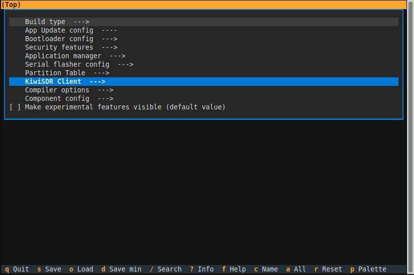
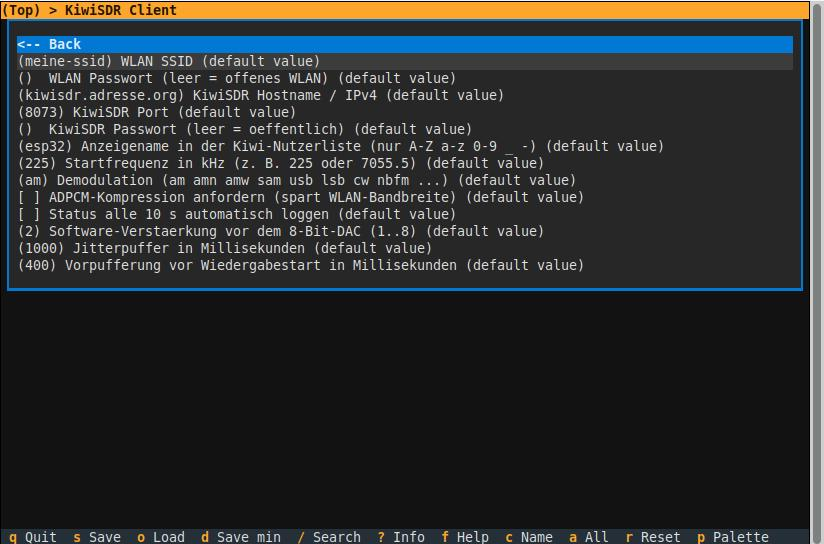
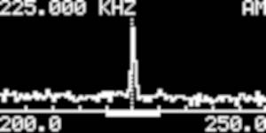
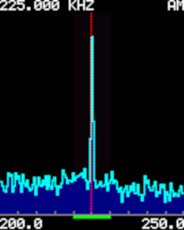
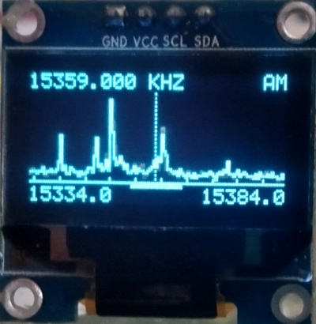
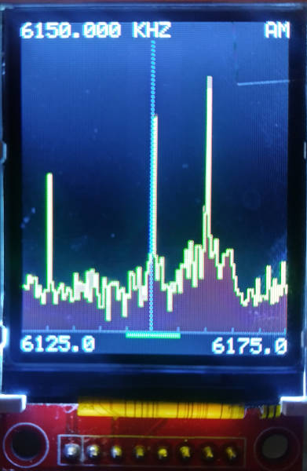

# KiwiSDR Client for ESP32, Pico W (RP2040), Pico 2 W (RP2350) and PC

[Deutsch](README.md) · **English**

Portable C code (C11) that connects to a KiwiSDR, sets frequency and
demodulation mode (AM among others), receives the audio stream and outputs it as PCM:

* **ESP32 (classic, ESP-IDF 6.1):** via the internal 8-bit DAC (GPIO25/GPIO26)
* **Pico W / Pico 2W:** see [Readme](/pico/README.en.md)
* **PC (Linux/macOS):** to a WAV file (or raw to stdout, e.g. for `aplay`)

The protocol core is **the same source code** on both platforms.

```
kiwi-esp32/
├── components/kiwi_core/        <- portable core (PC and ESP-IDF component)
│   ├── include/                    kiwi_client.h  kiwi_ws.h  kiwi_adpcm.h
│   │                               kiwi_port.h   kiwi_audio_sink.h
│   └── src/
│       ├── kiwi_ws.c               WebSocket (RFC 6455), no I/O
│       ├── kiwi_adpcm.c            IMA-ADPCM decoder
│       ├── kiwi_client.c           KiwiSDR protocol (state machine)
│       └── port_sockets.c          BSD sockets (Linux AND lwIP in ESP-IDF)
├── components/kiwi_dir/        <- portable directory service (server list, DB, selection), see section 7
│   ├── include/ + src/             parser, HTTP client, database (A/B slots), countries, d-commands
│   └── tools/gen_geo_table.py      generates the country map (src/kiwi_dir_geo_data.c)
├── main/                        <- ESP32 only: Wi-Fi, DAC sink, console, flash store, app_dir
├── pc/                          <- PC only: main, WAV sink, tests, mock Kiwi, kiwi_dirtool
├── pico/                        <- Pico W/2W only: Wi-Fi, DAC sink, console, flash store, app_dir
├── CMakeLists.txt, sdkconfig.defaults, partitions.csv
```

---

## 1 The KiwiSDR Audio Protocol (derived from `kiwiclient`)

The analysis is based mainly on `kiwi/client.py` (`KiwiSDRStream`),
`kiwi/wsclient.py` (handshake) and `kiwirecorder.py` (startup sequence).

### 1.1 Transport: WebSocket on the HTTP port

1. TCP connection to `host:8073`.
2. `GET /ws/kiwi/<timestamp>/SND HTTP/1.1` with `Upgrade: websocket`,
   `Origin: http://host:port`, `Sec-WebSocket-Key`, `Sec-WebSocket-Version: 13`.
   **The path prefix `/ws/kiwi` is mandatory on KiwiSDR v1.9xx** (verified by a browser
   capture against v1.902). With the legacy path `/<timestamp>/SND` (as used in the
   bundled `kiwiclient`) the server still answers `101` but then **never sends a single
   byte** – this was the cause of the initial timeout. For older Kiwis use `kiwi_pc -l`
   or `path_prefix = ""`.
   The timestamp is an arbitrary number that differs per connection. `SND` selects the
   audio channel (`W/F` would be the waterfall).
3. Response `101 Switching Protocols`. (`Sec-WebSocket-Accept` is not verified, as in
   the Python client.)
4. Client→server frames are **masked** (mandatory); server→client frames are not.

### 1.2 Control channel: text commands `SET …` and server `MSG`

| Direction | Message | Meaning |
|---|---|---|
| C→S | `SET auth t=kiwi p=<password>` (no password: `p=#`) | Authentication (immediately after the handshake) |
| C→S | `SERVER DE CLIENT kiwi_esp32 SND` | Client identification (the browser sends this as well) |
| S→C | `MSG sample_rate=11998.895009` | on v1.902 the **first** message: actual sample rate, channel ready |
| S→C | `MSG badp=0`, `MSG version_maj=1 version_min=902 …` | Authentication OK, version |
| S→C | `MSG audio_init=0 audio_rate=12000` | Nominal audio sample rate |
| C→S | `SET AR OK in=12000 out=44100` | **Mandatory acknowledgement**, otherwise no audio starts |
| C→S | `SET squelch=0 max=0`, `SET genattn=0`, `SET gen=0 mix=-1` | Neutral default values |
| C→S | `SET ident_user=<name>` | Display name |
| C→S | **`SET mod=am low_cut=-4900 high_cut=4900 freq=225.000`** | **Tuning**: mode, passband (Hz), frequency in **kHz** |
| C→S | `SET agc=1 hang=0 thresh=-100 slope=6 decay=1000 manGain=50` | AGC |
| C→S | `SET compression=0` | Raw PCM instead of ADPCM (optional) |
| C→S | `SET keepalive` | At least once per second, otherwise the server disconnects |
| S→C | `MSG too_busy=…`, `badp=1..7`, `down=…`, `redirect=…` | Errors |

`MSG` messages have the format `MSG<1 separator byte>name=value name=value …`.
Some of them (`load_cfg`, `load_dxcfg`) are tens of kilobytes in size and unnecessary
for audio reception – the client **discards** messages that do not fit into the
buffer (important for the RAM-constrained ESP32).

For a Kiwi with a frequency offset (up-converter, `freq_offset=`), the protocol expects
the *baseband* frequency = displayed frequency − offset; the client handles this
automatically.

### 1.3 Audio frames: `SND`

```
Offset  Length  Content
0       3       "SND"
3       1       flags: 0x02 ADC overflow, 0x08 stereo (IQ/DRM), 0x10 ADPCM, 0x80 LE (only "camp")
4       4       Sequence number, little endian
8       2       S-meter, big endian:  RSSI [dBm] = 0.1 · value − 127
10      …       Audio data
```

* On v1.902 a frame always carries 1024 payload bytes: **ADPCM = 2048 samples (≈ 171 ms)**,
  **raw PCM = 512 samples (≈ 43 ms)** (measured on the ESP32 with raw PCM: about 23 frames/s).
  `KIWI_RX_BUF_SIZE` = 6144 leaves ample headroom.
* **Raw (`flags&0x10 == 0`):** `int16`, **big endian**, mono.
* **ADPCM (`flags&0x10`):** IMA-ADPCM, 1 byte = 2 samples (**low nibble first, then
  high nibble**). The decoder state (predictor + step index) persists across all frames
  of the connection.
* The **first** SND frame may still contain audio from the previous channel user. It is
  decoded (to keep the ADPCM state correct) but not output.
* Between SND frames, `MSG user_cb=…`, `stats_cb=…` and similar (JSON, ignored by the
  client) arrive continuously, as well as large `load_cfg=…` messages (which are skipped).
* Gaps in the sequence number = lost frames (they are counted).

### 1.4 Shutdown

Send a WebSocket close frame (status 1001), let the connection drain briefly, close TCP.
(Closing the socket right away with unread data pending makes Linux send a TCP RST,
and the server may lose the close frame – the PC test uncovered exactly this, which is
why `kiwi_client_close()` keeps reading for up to 300 ms.)

---

## 2 Architecture and Portability

```
 Network ──► kiwi_port.h ──► kiwi_ws (frames) ──► kiwi_client (MSG/SND) ──► audio_sink_t
 (sockets)   (OS layer)      (pure bytes)         (state machine)           (WAV | DAC)
```

* **`kiwi_port.h`**: 6 functions (connect/send/recv/close/time/random). This is the only
  place that contains operating-system knowledge. `port_sockets.c` uses the BSD socket
  API, which exists on Linux/macOS *and* in lwIP → one file for both worlds.
* **`kiwi_ws.c`**: knows nothing about sockets; bytes in → messages out. It can therefore
  be tested without a network (`pc/test_core.c`).
* **`kiwi_client.c`**: knows neither the platform nor the audio hardware; it delivers PCM
  to an `audio_sink_t` (a struct of function pointers = "strategy" pattern).
* No `malloc` in the data path, no floating-point arithmetic (frequencies as fixed-point
  Hz), all buffers have a fixed size (`KIWI_RX_BUF_SIZE`, default 4 KB), tables are
  `const` (placed in flash).
* One thread/task runs the client (`poll`). Only `kiwi_client_set_tune()` may be called
  from another task (hand-over via `atomic_int`).

---

## 3 PC: Build and Test

Requirements: `gcc`/`clang`, `make`, `python3`.

```sh
cd pc
make              # builds kiwi_pc and test_core
make test         # core self-tests + end-to-end against a local mock Kiwi
```

**Against a real KiwiSDR (always exactly one connection, closed cleanly):**

```sh
./kiwi_pc -f 225 -m am -t 20 -o pl225.wav url.kiwiserver.org
```

Options: `-p port` · `-f kHz` · `-m mode` · `-t seconds` (0 = until Ctrl+C) ·
`-o file.wav` (`-` = raw to stdout) · `-c` ADPCM · `-w password` ·
`-l` legacy path without `/ws/kiwi` (Kiwi < v1.9xx) ·
`-i` interactive (commands `f 1008`, `m usb`, `s`, `q`).

Listen live (Linux): `./kiwi_pc -f 225 -t 0 -o - HOST | aplay -r 12000 -f S16_LE -c 1`
(the status display goes to stderr).

Debug output of all protocol messages: `make kiwi_pc_debug`.

---

## 4 ESP32: Build

```sh
. $IDF_PATH/export.sh            # ESP-IDF 6.1
idf.py set-target esp32
idf.py menuconfig                # menu "KiwiSDR Client": Wi-Fi, host, frequency, mode, gain
idf.py build flash monitor
```






**Hardware:** audio on **GPIO25** (DAC1) and **GPIO26** (DAC2, same signal).
Level 0…3.3 V around a midpoint of 1.65 V. For amplifiers/headphones:
10 µF in series (removes the DC offset) and an RC low-pass filter against the
staircase steps. The DAC has only 8 bits, so quantization noise is audible
(adequate for AM speech/broadcast, but not hi-fi).

**Operation via the serial console** (115200 baud): `f 1008` · `m usb` · `s` · `q`.

**Technical details:**
* The Kiwi delivers 12 kHz; the DAC DMA mode only works from ≈ 19.6 kHz upward. The
  signal is therefore automatically upsampled by a factor of 2 (linear interpolation to 24 kHz).
* Jitter buffer (default 1 s) with pre-buffering (400 ms); on underrun the output
  switches to silence and pre-buffers again; the counters are logged every 10 s.
* Reconnect with back-off delays of 5 → 10 → 20 → 40 → 60 s so as not to
  "hammer" the server. The last frequency and mode that were set are retained.

---

## 4.1 Raspberry Pico W / Pico 2 W: Build

see [Readme](/pico/README.en.md)

---

## 5 What Was Tested – and What Was Not

**Against a real Kiwi v1.902 (browser capture `browser.pcap`):**
* The browser capture was analysed frame by frame (path, headers, all `SET` commands
  and `MSG` responses). The path prefix, `p=#`, `Origin` and `SERVER DE CLIENT` all
  originate from it.
* The recorded server frames were replayed to the C client: no gaps, 12000 Hz
  detected, output **identical** to the reference decoding by the Python decoder.
* The C ADPCM decoder and the Python decoder produce bit-identical results on the
  browser data.

**Tested (Linux, `make test`):**
* ADPCM decoder **bit-identical** to the Python decoder from `kiwiclient`
  (48 reference samples including saturation).
* WebSocket parser: byte-by-byte feeding, 16-bit lengths, fragmentation with an
  interleaved ping, oversized frames, protocol errors, masking.
* End-to-end against a **local mock Kiwi** (`pc/mock_kiwi.py`, implements the protocol
  described above): authentication, `AR OK`, tuning
  `SET mod=am … freq=225.000`, raw PCM and ADPCM (a 1 kHz tone is detected correctly),
  a 20 KB `MSG` is skipped, ping/pong, tuning at runtime, `too_busy` error case, clean
  shutdown in all cases.

**Live connections** of the client to several real KiwiSDR servers
(different firmware versions, locations, load) were successful.

**Known limitations:** mono modes only (stereo/IQ/DRM are rejected), no TLS
(`ws://` instead of `wss://`), no URL encoding of the password, Kiwi↔DAC clock drift
is only absorbed by the buffer (overrun counter) and not actively compensated.
Only KiwiSDR is supported; WebSDR servers use a different protocol.

---

## 6 Target Audience and Motivation

PC clients for KiwiSDR and WebSDR are already plentiful (browsers, `kiwiclient`,
various desktop applications). This project deliberately targets a different area:
**embedded devices that use a remote SDR as "antenna and receiver from the network"
without the overhead of a full operating system.**

Typical applications:

* **Upcycling and retrofitting** of old tube, transistor or world-receiver enclosures
  that tap into a remote KiwiSDR instead of having their own RF front end
  (see e.g. the
  [element14 UpCycleIT project "Embedded Web-SDR Client on Analog Radio Receiver"](https://community.element14.com/challenges-projects/design-challenges/upcycleit/b/blog/posts/upcycle-it-design-challenge-embedded-web-sdr-client-on-analog-radio-receiver-1-introduction)).
* **Low-power always-on devices**, e.g. a kitchen, workshop or bedside radio,
  battery or solar operation.
* **Teaching and hobby projects** involving radio, WebSockets and embedded audio with
  compact, readable C code.
* **Reception where no good antenna is available** (rented flat, poor-reception
  locations), using a selected Kiwi in a low-noise area.

**Why not a Raspberry Pi or Jetson running a headless browser?**
The usual way to embed a web SDR into a device is a single-board computer running a
(headless) browser. For the task "receive an audio stream and output it" this is
heavily oversized: Linux boot, several hundred MB of RAM, high power consumption and
long start-up times, plus maintenance overhead (updates, SD-card wear).
An ESP32 (or a comparable MCU with Wi-Fi) does the same job with a few hundred KB of
RAM, starts within seconds and typically needs only a fraction of the power.

**Scope – what this project does not aim to be:**
It is not a replacement for the full web interface (no waterfall, no DX list, no
wideband IQ processing). It is about the audio of a single channel.

---

## 7 Server directory: load the list, filter by country, switch servers

The client knows the public KiwiSDR servers from a directory service
(default: `http://rx.linkfanel.net/kiwisdr_com.js`, ~0.9 MB, currently ~840 servers) and can switch
between them at runtime. Everything lives in its own component `components/kiwi_dir`; `kiwi_core`
(protocol, audio, old and new path) is unchanged.

```
 network ─► kiwi_dir_http ─► kiwi_dir_parse ─► resolve country ─► kiwi_dir_db (flash, slot A/B)
 (http)     GET, chunked,    streaming,         text + GPS          fixed 120-byte records,
            redirects        ~2.6 KB RAM                            checksum, commit at the end
```

### Usage (serial console or `pc/kiwi_dirtool`)

| Command | Effect |
|---|---|
| `d update` | download the list and renew the database (`d update force` ignores the minimum interval) |
| `d info` | servers/countries, generation, current filter |
| `d countries` | countries with number of usable servers |
| `d filter Germany` | filter by country (prefix works: `d filter Ger`); other text searches name/place/host; no argument clears the filter |
| `d free [off]`, `d snr 30`, `d freq 7055` | only free channels · minimum SNR (dB) · servers covering this frequency (kHz) |
| `d list [page]` | show matches (10 per page, numbered `#n`) |
| `d go 28` · `d go best` · `d go host:port` | switch to server no. 28 / the best match (highest SNR, free channel) / any host |

Example: `d update` → `d filter Switzerland` → `d list` → `d go 142`. A switch ends the running session
cleanly and reconnects immediately (frequency and mode are kept). The last server chosen with `d go` is
stored in NVS and used after a reboot instead of `KIWI_HOST`.

**Failover** (Kconfig `KIWI_DIR_FAILOVER`, on by default): if a Kiwi reports `too_busy`, `down`, wrong
password etc. before any audio arrived, the next match of the current filter with a free channel is used
(max. 5 in a row, 2 s pause between them).

### Data and storage

* **Stored** per server: host, port, name, place, country, coordinates, users/channels, SNR (0–30 MHz and
  1.8–30 MHz), receive range, flags (offline/private/https). Antenna text, SDR hardware, e-mail etc. are
  dropped on purpose. A URL without port means **8073**.
* **Flash:** partition `kiwidb` (`partitions.csv`, 384 KB) with **two 192 KB slots** (~1500 servers; ~840 are
  listed today). An update writes into the *inactive* slot and writes the header with a CRC-32 last
  (= commit). Abort, power loss or a broken list leave the old database untouched. The slot is erased only
  when the first valid server arrives (if the download fails early the flash is not touched). A list with
  fewer than a quarter of the old entries is rejected.
* **RAM:** no database in RAM, records are read from flash one at a time. During an update a task uses about
  9 KB heap + 8 KB stack, all freed afterwards.
* **Politeness:** manual updates only, 60 s minimum interval (`KIWI_DIR_MIN_INTERVAL_S`), a clear User-Agent.
  Slight audio dropouts are possible during the 2–3 s erase.
* The HTTP client does `http://` only (no TLS); servers with an `https://` address are stored but hidden
  by the filter and cannot be selected.

### Countries: why text *and* coordinates?

The directory's `loc` field is **free text** ("Stevensville, MT", "ALPA CORRAL ARGENTINA"), not a
coordinate field; coordinates are in `gps` as `(lat, lon)`. A country can only partly be read from the
text, so `kiwi_dir_geo.c` combines two sources:

1. **Text:** known country names and aliases (UK, Deutschland, Holland, Azores …) as a whole word in `loc`/`name`.
2. **Coordinates:** a built-in 0.5° raster map (13 KB flash, generated by `tools/gen_geo_table.py` from
   *Natural Earth 1:110m*, public domain; about ±50 km accuracy at borders).

On conflict the text only wins if that country is also within ±1° of the coordinates, so "Holland, MA" and
"Peru, IL" become *USA*, while "Freital, Germany" (near the border) stays *Germany*. On the 2 Nov 2026 list,
text and raster agreed for 640 of 836 servers, 162 had no country in the text, 24 disagreed (all resolved
correctly) and 5 island groups were added as aliases. Small states missing from the raster (Singapore, Malta,
Monaco …) are recognised from the text only.

### Tests

`make test` (in `pc/`) now also runs `test_dir` (byte-by-byte parser, escapes/unicode, countries, database on
a flash emulation incl. A/B swap, abort, corruption, capacity, commands) and `e2e_dir_test.py`
(`kiwi_dirtool` against a local HTTP mock with redirect, `chunked`, error pages, truncated reply, https
redirect, 2000 servers). Try it offline:

```sh
cd pc && make
./kiwi_dirtool -d kiwidb.bin -f testdata/kiwisdr_sample.js "d update" "d countries" "d filter Germany" "d list"
./kiwi_dirtool -d kiwidb.bin "d update"      # real download from rx.linkfanel.net
```

**Upgrading an existing project:** `sdkconfig.defaults` only applies when `sdkconfig` is generated. For the new
partition table run `idf.py fullclean`, delete `sdkconfig`, `idf.py set-target esp32` – and flash everything once
(`idf.py flash`), since the partition table changes.

**Limits:** order and selection follow the directory's list; if it ever exceeds ~1500 servers the surplus is
counted and dropped. No automatic update (there is no clock/SNTP) – on command only.

---

## 7a Optional spectrum display (SSD1306 / SH1106 / ST7735)

Shows the **current** spectrum around the tuned frequency (default 50 kHz wide = ±25 kHz) on a small display –
no waterfall history, just for orientation. **Off** by default (no extra display code in the image).

*PC Version/Simulation*




*Real MCU/Display*





| target | activate | pins/display |
|---|---|---|
| ESP32 | `idf.py menuconfig` → *KiwiSDR Client* → *Spektrumanzeige* | Kconfig (`KIWI_SPEC_*`) |
| Pico | `cmake -DKIWI_SPEC=ON -DKIWI_SPEC_PANEL=ssd1306_i2c …` | `KIWI_SPEC_*` in `pico/CMakeLists.txt` |
| PC | `./kiwi_pc -D ssd1306 -P bild.ppm -W …` (simuliertes Panel) | `-D ssd1306\|ssd1306spi\|st7735`, `-S kHz` |


A second WebSocket `/W/F` is opened with the **same timestamp** as `/SND`; each 1024-bin line is reduced to the
display width on arrival (max-hold), no frame buffer. **Caveat:** KiwiSDR servers usually reject a second
*independent* client from the same IP, and busy servers may have no free waterfall channel. `/W/F` is therefore
optional and non-fatal: on rejection audio continues unchanged, the display shows "NO DATA", and there is no
retry in that session. Estimated cost (not measured): 3–6 KB RAM, 2–4 KB/s, <1 % CPU.

**tested on PC** (`make test`: 74 unit checks + end-to-end against a mock); ESP32/Pico glue, HALs and build
files were not built with IDF/Pico SDK here; 

**live test:** on real ESP32-/Pico-hardware: Headless, SSD1306 I2C, ST7735 with multiple KiwiSDR server

---

## 8 TODO

* [x] ~~Automatic synchronisation with a directory service~~ – done in section 7 (manual update,
  country filter, runtime switching, failover).
* [ ] Scheduled update (e.g. daily using SNTP time) and per-server "last reachable" statistics.
* [ ] `https://`/`wss://` (TLS) for Kiwis reachable only encrypted.
